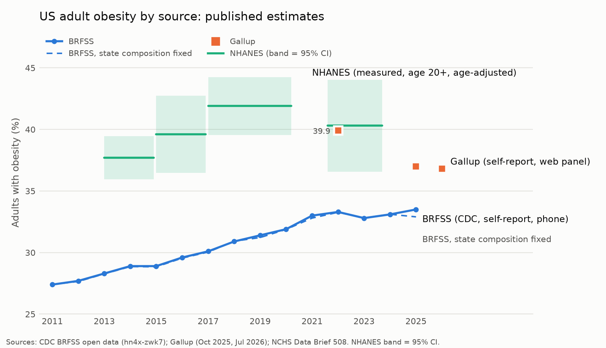

# H0: source reconciliation (pre-registration part)

14 November 2026 · Descriptive hypothesis, no test (Q4 and Q19). This part uses published numbers only. The
age-specific comparison with BRFSS microdata and the H1 MRP series are added after registration, with the code
already in `src/glp1_review/h0_sources.py`.

Data: [dados_externos/published_estimates.csv](../dados_externos/published_estimates.csv) (every number with
its source, location in the text or a table, derivation and whether it was verified) and
[dados_externos/source_design.csv](../dados_externos/source_design.csv). To regenerate the figure:
`uv run python -c "from pathlib import Path; from glp1_review import h0_sources as h0; h0.plot_published_series(Path('docs/figures/h0_published_series.png'))"`.

## National series

| Year | BRFSS (CDC) | BRFSS, state composition fixed | Gallup |
| --- | --- | --- | --- |
| 2011 | 27.4 | 27.41 |  |
| 2012 | 27.7 | 27.65 |  |
| 2013 | 28.3 | 28.27 |  |
| 2014 | 28.9 | 28.86 |  |
| 2015 | 28.9 | 28.84 |  |
| 2016 | 29.6 | 29.55 |  |
| 2017 | 30.1 | 30.04 |  |
| 2018 | 30.9 | 30.92 |  |
| 2019 | 31.4 | 31.22 |  |
| 2020 | 31.9 | 31.88 |  |
| 2021 | 33.0 | 32.80 |  |
| 2022 | 33.3 | 33.27 | 39.9 |
| 2023 | 32.8 | 32.81 |  |
| 2024 | 33.1 | 33.11 |  |
| 2025 | 33.5 | 32.90 | 37.0 |
| 2026 |  |  | 36.8 |

NHANES (measured height and weight, adults 20+, age-adjusted, NCHS Data Brief 508):

| Cycle | Obesity (%) | SE |
| --- | --- | --- |
| 2013-2014 | 37.7 | 0.9 |
| 2015-2016 | 39.6 | 1.6 |
| 2017-2020 | 41.9 | 1.2 |
| 2021-2023 | 40.3 | 1.9 |

**Change 2022 to 2025:** Gallup −2.9 points; BRFSS as published +0.2; BRFSS with the state composition held fixed
−0.37 (the published 2025 value excludes California, Mississippi and Nevada).

Levels also differ: BRFSS is about 6 points below Gallup and 7 below NHANES. NHANES measures height and weight;
the other two rely on self-report, which understates obesity.

## By age and sex (Gallup, 2022 to 2025)

| Group | Gallup 2022 | Gallup 2025 | Change | Status |
| --- | --- | --- | --- | --- |
| 18-29 | | | "essentially unchanged" | no number in the text |
| 30-39 | | | −2.2 | levels not published |
| 40-49 | 47.6 | 43.3 | −4.3 | 2022 derived (2025 + 4.3) |
| 50-64 | 47.8 | 42.8 | −5.0 | 2022 derived |
| 65+ | | | "essentially unchanged" | the +0.8 cited in the literature review **is not in the text**; probably read from the interactive chart; confirm before citing |
| Men | 37.5 | 35.2 | −2.3 | 2022 derived |
| Women | 42.3 | 38.8 | −3.5 | 2022 derived |

After registration, `brfss_by_gallup_groups` computes BRFSS obesity in exactly these groups (the 5-year
`_AGEG5YR` codes allow it) and `age_change_table` sets the two sources side by side.

## Design differences

| Aspect | BRFSS | Gallup | NHANES |
| --- | --- | --- | --- |
| Data collection | Telephone (landline and cell), random-digit dialing | Web, probability-based Gallup Panel | Household interview + mobile examination center |
| Height and weight | Self-reported: "About how much do you weigh without shoes?" / "About how tall are you without shoes?" (2024 codebook) | Self-reported (wording not published) | Measured |
| Age | 18+ | 18+ | 20+ |
| Sample | ~350,000-510,000 a year (356,158 in 2025) | 3,035 (2022); 5,577 (2024); 16,946 (2025); 10,091 (2026) | 5,929 in Aug 2021-Aug 2023 |
| Fieldwork | Throughout the year | A few weeks a year | Two-year cycles; 2017-2020 cut short by the pandemic |
| Weighting | Raking to age, sex, race and ethnicity, education, marital status, home tenure and phone ownership | Nonresponse weights calibrated to the CPS (gender, age, race, Hispanic ethnicity, education, region); revised in Sep 2026 | Examination weights; total age-adjusted to the 2000 Census |

## What the comparison already shows

1. **The sources diverge in trend, not only in level.** From 2022 to 2025 Gallup falls 2.9 points while BRFSS is
   essentially flat (−0.4 with the state composition fixed). Level differences between self-report and
   measurement are well known; opposite trends need an explanation.
2. **Gallup's peak rests on a small sample.** The 2022 estimate comes from 3,035 interviews in one January week,
   with a margin of ±2.0 points; part of the decline may be noise in the starting point.
3. **Gallup's weighting changed in September 2026** and the 2026 article was revised, which complicates
   comparisons across its years.
4. **NHANES does not cover the period of the decline:** its last cycle ends in August 2023.

## Open items

- Confirm the +0.8 at ages 65+ in Gallup's chart, or leave it out.
- Gallup's full annual series (2008-2021) exists only in the interactive chart; the text says only that obesity
  rose "over 14 percentage points" since 2008. If needed, it must be read from the chart and recorded as such.
- The list of BRFSS raking variables comes from the first pre-registration draft (Q9); check it against the CDC
  weighting documentation before publication.
