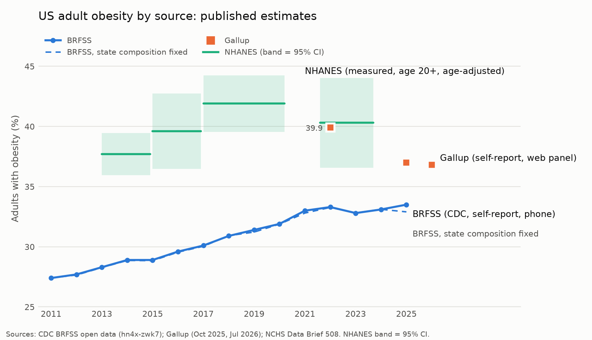

<!--
Skeleton of 14 November 2026, written before the OSF registration. Placeholders in double braces are filled from
the pipeline outputs (resultados/analysis/<run>/) after registration; paper/README.md maps every placeholder to its
source file and key. Only the published-estimates part of H0 (section 5.1) contains numbers now.
Convert with pandoc: see paper/README.md.
-->

# Introduction

Adult obesity in the United States rose almost every year for three decades. After 2022 the curve bent: the
share of adults with obesity reported to the Behavioral Risk Factor Surveillance System (BRFSS) stopped rising,
Gallup's web panel reported a fall from 39.9% in 2022 to 37.0% in 2025 [@gallup2025], and measured BMI in
the electronic records of 16.7 million adults fell slightly in 2023 [@rader2024]. Over the same years the use of
GLP-1 receptor agonists (semaglutide, tirzepatide and related drugs) multiplied: by late 2025, 12% of US adults,
and 45% of adults with diabetes, reported taking one [@kff2025]. Among adults with diabetes, use was already
rising before 2020 [@galindo2023], and in 2024 about a quarter used an injectable GLP-1 [@nchs537].

The coincidence invites a causal reading, and the reports so far are consistent with it: the fall is largest in
the South, where dispensing is highest [@rader2024], and at ages 40–64, where use is highest [@gallup2025]. But
coincidence in time, region or age is also what secular change, survey artefacts or the end of the pandemic would
produce. No study has asked whether the change has the *shape* that the drugs would give it.

This paper tests that shape. If GLP-1 drugs explain the bend, several predictions must hold together: the
departure should be larger among adults with diagnosed diabetes, who use the drugs several times more often; it
should start in the upper tail of the BMI distribution, where the drugs are prescribed; it should be larger in
states with higher use; it should match what uptake, persistence and per-user weight loss can produce; and
individuals who start the drugs should lose BMI relative to those who do not. Each prediction can fail, and a
measurement artefact would make them come apart. All hypotheses, models and decision rules were registered on the
Open Science Framework before any outcome microdata were analysed ({{OSF.DOI}}).

# Data

## BRFSS, 2011–2025

The BRFSS is a state-based telephone survey of non-institutionalized adults, with landline and cell-phone samples
since 2011 [@cdcbrfss]. We use the 15 annual public-use files from 2011 to 2025, restricted to adults in the 50
states and the District of Columbia with a valid body-mass index (6,048,517 interviews). Height and weight are
self-reported ("About how much do you weigh without shoes?"; "About how tall are you without shoes?"). Some
states are missing in some years (New Jersey 2019; Florida 2021; Kentucky and Pennsylvania 2023; Tennessee 2024;
California, Mississippi and Nevada 2025).

Because www.cdc.gov refused automated downloads, the annual files were obtained as a column-for-column Parquet
conversion of the CDC files built from Internet Archive captures of the CDC URLs, at a pinned revision
[@hfbrfss]. Before any other use we reproduced the published state-year obesity prevalence from the CDC open-data
API: across 792 state-years the mean absolute difference was 0.025 percentage points (maximum 0.12), and the
national series matched within 0.05 points in every year. The diabetes item changed name in 2019 (DIABETE3 to
DIABETE4).

## MEPS, 2018–2024

The Medical Expenditure Panel Survey Household Component [@meps] links individual prescription purchases, with
drug names, to self-reported BMI, which adults report in even years. We use the full-year consolidated and
prescribed-medicines files for 2018–2024 and the four-year longitudinal files of Panels 23 (2018–2021) and 24
(2019–2022), in which the same person reports BMI twice. GLP-1 use is a purchase of semaglutide, tirzepatide,
liraglutide, dulaglutide, exenatide, lixisenatide or albiglutide. The primary longitudinal sample has
{{H6.N_INITIATORS}} initiators and {{H6.N_NEVER}} never-users (89 and 5,211 when counted before registration).

## State GLP-1 use, population and published comparators

State use is measured by three indicators: Medicare Part D GLP-1 claims per 100 adult residents in 2024
[@cmspartd], Medicaid GLP-1 prescriptions per 1,000 enrollees in 2025 [@cmssdud], and all-payer prescriptions per
100 residents in 2024 (PurpleLab, as audited by The RX Index). Post-stratification uses American Community Survey
1-year public-use microdata, 2011–2024, for adults outside institutional group quarters, and Census Bureau state
population estimates (Vintage 2025) convert departures into numbers of adults. For the source comparison we use
Gallup's published estimates [@gallup2025; @gallup2026] and NHANES measured estimates [@nchs508].

# Pre-registration

The registration ({{OSF.DOI}}, {{OSF.DATE}}), which follows the secondary-data template of @vandenakker, fixed the hypotheses, models, smallest effects of interest, inference
criteria and sensitivity analyses below, and the analysis code, written and tested on simulated data, was archived
with it. Before registration the microdata were used only to reproduce published aggregates and to count cases.
Changes made to the first draft before registration, each with its reason, are listed in Appendix A.
{{DEVIATIONS.AFTER_REGISTRATION}}

| | Hypothesis | Prediction | Role |
| --- | --- | --- | --- |
| H0 | Source reconciliation | Describe why Gallup falls and BRFSS does not | Descriptive |
| H1 | Trend break | Obesity in 2023–2025 below its 2011–2019 trajectory, gap widening | Estimation target |
| H2 | Diabetes contrast | Larger departure in mean BMI among adults with diagnosed diabetes | Confirmatory |
| H3 | Upper-tail signature | 90th percentile of BMI departs more than the median | Confirmatory |
| H4 | State dose–response | Larger departure where use is higher | Estimation target |
| H5 | Mechanical plausibility | Departure within what uptake × persistence × loss can produce | Consistency check |
| H6 | Individual change | GLP-1 initiators lose BMI relative to never-users; no change before initiation | Confirmatory |
| NC1 | Height | No departure in self-reported height (±0.5 cm) | Negative control |
| NC2 | Placebo break | No departure at a pseudo-break in 2017 | Negative control |

: Pre-registered hypotheses. {#tbl:hypotheses}

**Inference.** The three confirmatory predictions are directional and tested one-sided with Holm's adjustment
[@holm1979]. A hypothesis is *supported* if its Holm-adjusted p-value is below 0.05; *contradicted* if the whole
90% confidence interval lies above minus its smallest effect of interest (−0.2 kg/m² for H2, −0.3 for H3, −0.5
for H6), which includes significant estimates in the opposite direction; and *inconclusive* otherwise. The
overall verdict is "signature present" if at least two of H2, H3 and H6 are supported, none is contradicted and the
height control passes; "absent" if at least two are contradicted or the height control fails; and "mixed"
otherwise.

# Methods

## H1: departure from the 2011–2019 trajectory

For each year we fit a multilevel logistic model of obesity to cells of state × age group (6) × sex × race and
ethnicity (5) × education (4) [@park2004]. State effects are centred on a division effect plus a predictor built
from the state's direct estimate in the previous available year, so that states missing in a year are predicted.
Group effects are normal with half-normal scales and constrained to sum to zero, sex enters as a fixed effect, and
the model is fitted with the No-U-Turn sampler in PyMC (4 chains × 1,000 draws). Post-stratification to ACS adult
counts gives posterior draws of national prevalence. For each draw a linear trend in the logit of prevalence is
fitted to 2011–2019 and projected to 2023–2025 with its closed-form posterior predictive (Student-t, 7 degrees of
freedom); the departure is observed minus projected prevalence.

## H2: diabetes contrast

On individual BRFSS records, a survey-weighted regression of BMI on state × year fixed effects, age group × sex,
race and ethnicity, education and income, and a diagnosed-diabetes indicator interacted with age group, sex and
year, gives the diabetes gap for every year. A linear trend plus a level shift at the 2019 item change is fitted
to the 2011–2019 gaps and projected to 2023–2025; the estimand is the mean departure of the gap, π̄, in kg/m², with
the Student-t predictive (6 degrees of freedom) as reference distribution. This two-stage inference includes
year-level shocks to the gap, which a single regression's design-based standard error would ignore.

## H3: upper tail

Each year's sample is reweighted to the 2017–2019 joint distribution of age group, sex, race and ethnicity and
education [@dinardo1996]. Weighted BMI quantiles (10th to 95th percentiles) go through the same trend procedure,
and the estimand is the mean 2023–2025 departure of the 90th percentile minus that of the median. Uncertainty comes
from a Rao–Wu rescaled bootstrap of primary sampling units within strata [@rao1988] (500 replicates), repeating
the reweighting, quantiles and projection in each replicate.

## H4: states

The exposure is the posterior mean of a one-factor model of the three standardized use indicators. An event study
of state obesity on state and year effects and exposure × year interactions, normalized to 2015–2019, gives β*,
the mean 2023–2025 coefficient minus its projection from a linear trend in the 2011–2019 coefficients. Inference
uses a two-sided randomization test that permutes the exposure across states (20,000 permutations) and smoothness
bounds for pre-trends [@rambachan2023], computed conservatively; uncertainty in the exposure is propagated over
200 posterior draws with Rubin's rules [@rubin1987]. A dose–response analysis following
@callaway2024 contrasts the top and bottom terciles of exposure and reports the average causal response.

## H5: mechanical plausibility

A microsimulation applies GLP-1 use probabilities by BMI class and diabetes (MEPS 2024), scaled so that national
use lies between the MEPS 2024 rate and the 12% reported for 2025 [@kff2025], one-year persistence
[@rodriguez2025] and per-user weight loss from real-world cohorts and trials [@rodriguez2024; @gasoyan2025;
@wilding2021; @jastreboff2022] to the 2025 BRFSS BMI distribution, giving the obesity reduction the drugs could
produce (10,000 draws).

## H6: individual change

In the MEPS panels, a weighted regression of the two-year change in BMI on initiation (first purchase between the
two measurements), panel, a quadratic in baseline BMI and baseline covariates compares initiators with never-users,
with design-based standard errors. Late initiators in Panel 23, who start only after the second measurement, are a
placebo; the comparison of initiators with late initiators is a not-yet-treated contrast.

## Negative controls and sensitivity analyses

Self-reported height of adults 25–64, composition-adjusted as in H3, must show no departure (equivalence within
±0.5 cm) [@lakens2017]. The H1 and H2 procedures applied to a pseudo-break in 2017 must show none either. The
pre-registered sensitivity analyses (alternative counterfactual trends, pandemic years removed, balanced panel of
states, multiple imputation of missing BMI, interview mode, and hypothesis-specific variants) are reported in full
in Appendix B.

All code, from download to tables, is in the project repository and the OSF archive ({{REPO.URL}}).

# Results

## Sources disagree on the trend, not only on the level (H0)

The three sources differ in level, as expected from self-report against measurement: NHANES, which measures height
and weight, found 40.3% of adults with obesity in August 2021–August 2023 [@nchs508]; Gallup reported 39.9% in 2022
and BRFSS 33.3% (Figure 1). They also differ in direction. From 2022 to 2025 Gallup fell 2.9 points, while BRFSS
rose 0.2 points as published and fell 0.4 points once the states missing in 2025 are accounted for. Gallup's 2022
peak rests on 3,035 interviews collected in one January week (margin ±2.0 points), and its weights were revised in
September 2026; NHANES ends before the period of the decline.

{#fig:h0}

{{H0.AGE_COMPARISON}} *(BRFSS change from 2022 to 2025 in Gallup's age groups, against Gallup's published
changes: −4.3 points at 40–49 and −5.0 at 50–64.)*

## The departure from the 2011–2019 trajectory (H1)

{{H1.TEXT}} In 2025, obesity was {{H1.D2025}} percentage points (95% credible interval {{H1.D2025_CI}}) from its
projected value, about {{H1.D2025_MILLIONS}} million adults; the probability that the 2025 departure exceeds the
2023 departure is {{H1.P_WIDENING}}. Classification: {{H1.CLASS}}.

## Diabetes contrast (H2)

{{H2.TEXT}} π̄ = {{H2.EST}} kg/m² (SE {{H2.SE}}; Holm-adjusted one-sided p {{H2.P_HOLM}}): {{H2.CLASS}}.

## Upper tail (H3)

{{H3.TEXT}} C = {{H3.EST}} kg/m² (SE {{H3.SE}}; Holm-adjusted p {{H3.P_HOLM}}): {{H3.CLASS}}.

## States (H4)

{{H4.TEXT}} β* = {{H4.EST}} percentage points per standard deviation of use (permutation p {{H4.P_PERM}};
smoothness-bound interval at M = 0.02: {{H4.RR002}}). Without West Virginia, Kentucky, Louisiana and Oklahoma:
{{H4.NO4}}. Classification: {{H4.CLASS}}.

## Individual change (H6)

{{H6.TEXT}} Initiators changed BMI by {{H6.EST}} kg/m² relative to never-users over two years (SE {{H6.SE}};
Holm-adjusted p {{H6.P_HOLM}}); late initiators (placebo): {{H6.LATE}}. Classification: {{H6.CLASS}}.

## Mechanical plausibility (H5)

{{H5.TEXT}} The microsimulation gives a reduction of {{H5.MEDIAN}} percentage points (90% range {{H5.RANGE}}),
against the observed departure of {{H1.D2025}}: {{H5.CLASS}}.

## Negative controls

Height: {{NC1.EST}} cm (90% CI {{NC1.CI90}}); {{NC1.CLASS}}. Placebo break in 2017: {{NC2.TEXT}}.

## Overall verdict

{{VERDICT.OVERALL}}

# Discussion

{{DISCUSSION}}

**Limitations known before the results.** BMI in BRFSS and MEPS is self-reported, and its bias may change with
the interview mode, which shifted from landline to cell phone over the period. State use measures count claims or
prescriptions, not people; Medicare counts by prescriber state, and only one measure, from a commercial source,
covers private insurance. The MEPS panels end in 2022, before the largest increase in use, and include
{{H6.N_INITIATORS}} initiators, so H6 has limited power at its smallest effect of interest. The BRFSS files were
obtained through a mirror of Internet Archive captures, validated against the CDC aggregates, and a later CDC
re-release would not be reflected. Several states are missing in some years, including three in 2025.

# Data and code availability

All data are public. Download scripts with checksums, provenance records, the analysis code and its tests, and the
pre-registration are in {{REPO.URL}} and in the OSF project ({{OSF.DOI}}).

# Use of AI assistance

The pilot, the download scripts, the analysis code and drafts of this paper were prepared with an AI assistant
(Claude, Anthropic) under the author's direction. The author is responsible for every analytic decision and for
the text.

# Funding and competing interests

No funding. The author declares no competing interests.

# Appendix A. Changes to the first pre-registration draft {-}

Made before registration, with reasons, in `docs/decision_log.md`: one-sided tests and a reachable contradiction
rule for the confirmatory family (Q21, Q22); two-stage inference for H2 (Q19); the placebo window of H2 restricted
to 2017–2018 because the diabetes item changes in 2019; sum-to-zero group effects and sex as a fixed effect in the
MRP model, which did not converge as first specified (Q19, Q23); a two-sided permutation test and conservative
smoothness bounds for H4; race treated as "not available" in 2015–2016; the 12% KFF rate as the upper bound of
national use in H5.

# Appendix B. Sensitivity analyses {-}

The RIF variant of H3 follows @firpo2009. The comparison with external projections made before the rise in use
[@ward2019; @decleene2026] and the NHANES-calibrated correction of self-reported BMI [@ward2019] are
{{Q24.EXTERNAL}}.

{{Q24.TABLE}}

# References {-}
